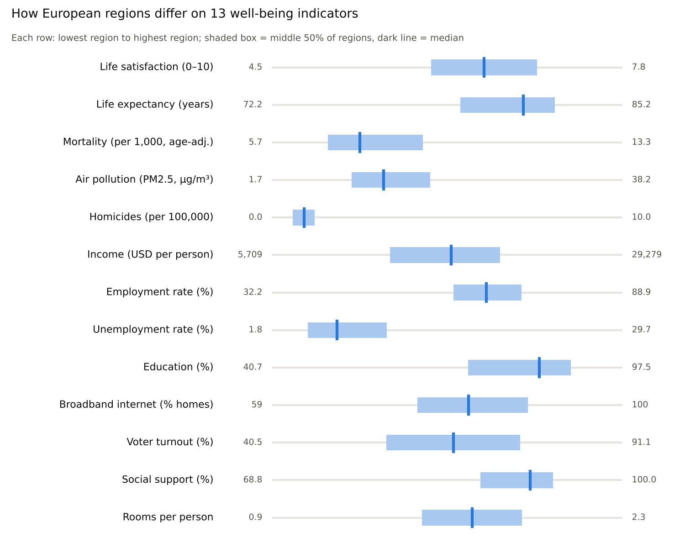
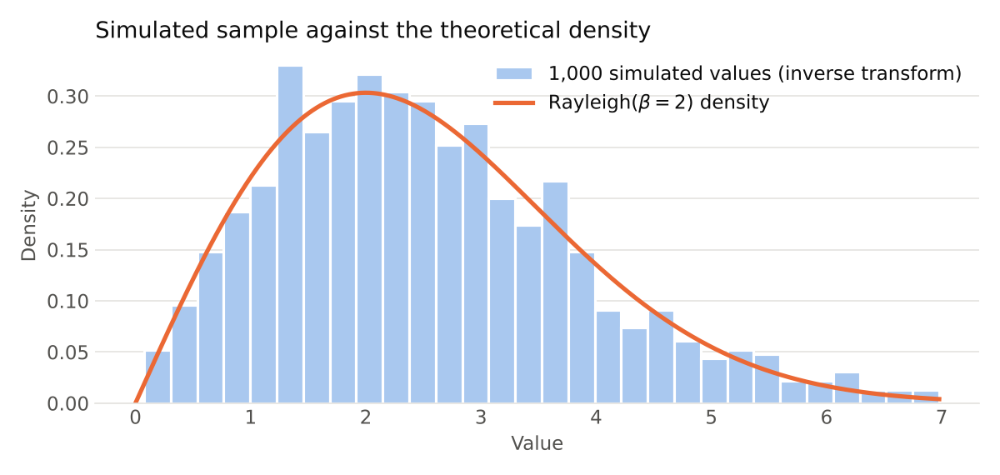

# Well-being in European Regions (R)

Statistical analysis of well-being indicators across European regions (education, jobs, income, health, safety, environment, civic life and life satisfaction), followed by hypothesis testing, bootstrap confidence intervals and a small random-number simulation study.

Group project for *Statistics and Data Science Lab* (Instituto Superior Técnico, 2025).



## Questions

1. **Do regions with cleaner air live longer?** Shapiro–Wilk rejects normality, so the link between PM2.5 pollution and life expectancy is tested with a one-sided **Spearman** rank correlation.
2. **Are people in Southern Europe more satisfied with life?** One-sided **Wilcoxon rank-sum** test, repeated without outliers to check robustness.
3. **Does unemployment differ between European subregions?** **Kruskal–Wallis** test.
4. **How precise is the typical life expectancy?** 95% **bootstrap-t** confidence intervals for the 5% trimmed mean and the median, implemented by hand (with nested resampling for the standard errors) and checked against the `boot` package.

## Key findings

- **Pollution and life expectancy:** weak negative correlation (Spearman ρ ≈ −0.10, p ≈ 0.068). The trend is there, but it is not significant at 5%, which suggests other factors such as healthcare matter more.
- **Life satisfaction:** contrary to our starting hypothesis, satisfaction is *lower* in Southern Europe (median ≈ 6.3 against ≈ 6.6 elsewhere), and the difference is significant (p ≈ 0.0006).
- **Unemployment:** differs strongly between subregions (Kruskal–Wallis, p < 0.001). Southeast Europe has the highest rates; Scandinavia and Central Europe the lowest.
- **Bootstrap:** the hand-written bootstrap-t intervals for life expectancy match the `boot` package to within 0.03 years.
- **Simulation:** both Rayleigh generators pass the Kolmogorov–Smirnov test (p > 0.05).



## What the analysis covers

- Outlier detection with box plots and `rstatix::identify_outliers`
- Summary statistics and the regions at the extremes of each indicator
- Country and subregion comparisons with `dplyr` and `ggplot2` (combined with `patchwork`)
- Non-parametric hypothesis tests
- Bootstrap-t intervals written from scratch
- **Simulation** (`rayleigh_simulation.R`): Rayleigh random numbers generated by the inverse transform and by Box–Muller, validated with Kolmogorov–Smirnov tests against the `VGAM` generator

## Running it

```r
install.packages(c("readxl", "dplyr", "tidyr", "ggplot2", "patchwork", "rstatix", "boot", "VGAM"))

source("wellbeing_analysis.R")    # run from the repository root
source("rayleigh_simulation.R")
```

**Data:** the analysis uses a spreadsheet extracted from the [OECD Regional Well-Being](https://www.oecdregionalwellbeing.org/) database, provided by the course. It is not included in this repository. To run the analysis, place it at `data/BemEstarEuropa.xlsx`; its Portuguese column names are renamed to English when it is loaded. `rayleigh_simulation.R` needs no data.

The figures in this README are drawn by `figures/make_figures.py`: the indicator chart uses the summary statistics from the project report (the spreadsheet itself is not included), and the Rayleigh chart is a Python port of the simulation.

## Authors

Carolina Baptista and group colleagues, Instituto Superior Técnico.
